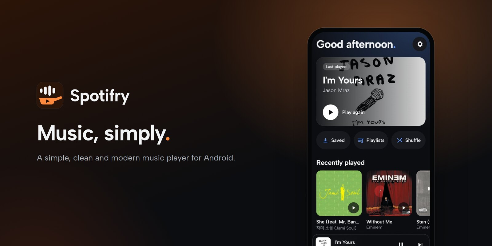

<div align="center">



[](../../releases/latest)
[](#download)
[](LICENSE)

[**Website**](https://alnyz.github.io/spotifry/) · [**Download**](#download) · [**Features**](#features) · [**Disclaimer**](#disclaimer) · [**Build**](#build)

</div>

> [!IMPORTANT]
> Spotifry is not affiliated with or endorsed by YouTube, Google, Spotify or JioSaavn. Songs come from YouTube through [NewPipe Extractor](https://github.com/TeamNewPipe/NewPipeExtractor), straight from your phone. If you turn on the optional 320 kbps switch, songs JioSaavn has also come from JioSaavn's website. There is no Spotifry server in between.

---

<h2 align="center"><a id="features"></a>Features</h2>

| Feature | Description |
|---|---|
| Search and play | Songs, music videos, albums, artists or playlists from YouTube. The top results are made ready while you look, so a tap plays in under a second. |
| Artists and albums | An artist's songs and albums on one page, and full albums to play or save as a playlist. |
| Music on your phone | Plays the music files already on your phone, from Saved and in search. |
| Equalizer | Ready-made sounds or your own curve, drawn on a graph, with a live picture of the music. |
| Crossfade | Songs overlap for 2 to 12 seconds as one runs into the next. When both have a clear, similar beat they line up on it, and the first 3 seconds or so of the next song are skipped to do that. |
| Speed and pitch | Each set on its own, kept for every song. |
| Same loudness | Quiet songs are turned up and loud ones down. |
| Skip quiet parts | Jumps over long silent intros and endings. |
| Trim | Cut a song's start and end yourself. Talking at the start and end of music videos is cut by itself, from [SponsorBlock](https://sponsor.ajay.app)'s shared list. |
| Sleep timer | Fades the music out and stops after a set time or at the end of the song. |
| Offline | Save songs to the phone. Recently played songs (up to 1 GB) replay without using data. |
| Playlists | Search, sort, put in your own order, or shuffle. Songs already in a playlist carry a small mark. Bring in a public Spotify playlist from its link. |
| Queue | Drag songs to reorder, swipe to remove. Shuffle spreads artists out; smart shuffle mixes in similar songs. |
| Share | Send a song or a playlist as a link, a list or a picture. |
| Lyrics | Light up word by word as they're sung when [BetterLyrics](https://github.com/better-lyrics/better-lyrics) has the song, else line by line from [LRCLIB](https://lrclib.net). Now playing shows the line before, the one being sung and the next one; tap them for all lyrics. |
| Keeps playing | With the screen off, controlled from the lock screen, the notification and a home screen widget. Similar songs play when the queue ends, and a song that can't play is skipped at once. |
| Data saver | Lower quality on mobile data. Wi-Fi stays high. |
| 320 kbps from JioSaavn | Off by default; a switch in Settings. When on, a song JioSaavn also has, matched by title, artist and length, plays at 320 kbps instead of YouTube's roughly 160 kbps. Unofficial: it reads JioSaavn's public website, mostly has Indian music, and may not work outside India. A song without a sure match plays from YouTube. |
| Your listening | A page with your minutes, plays, songs, artists and days, your top songs and artists, and a calendar of the days you played. It stays on your phone. |
| Backup | Save your playlists, saved songs list, history, listening, settings and trims into one `.zip` on your phone, and restore it on a new phone or after a reinstall. The audio files are not in it; saved songs download again. |
| Look | Light or dark or follow the phone, pure black, and any accent colour, including your wallpaper's. |
| Updates | The app tells you when a new version is out and installs it for you. |

---

<h2 align="center"><a id="download"></a>Download</h2>

1. On your phone, open [Releases](../../releases) and download the newest `spotifry-x.y.z.apk`.
2. Open the file. Android will ask whether your browser or file manager may install apps. Allow it once.
3. From version 0.2.0 on, the app tells you when an update is out and installs it for you. Your songs and playlists stay.

Needs Android 8 or newer.

> [!NOTE]
> YouTube changes its site from time to time. When that breaks search or playback, it stays broken until NewPipe Extractor is fixed and a new Spotifry release comes out.

---

<h2 align="center"><a id="disclaimer"></a>Disclaimer</h2>

- **Free and non-commercial.** Spotifry is open-source software made for personal use and for learning. It makes no money: no ads, no paid features, no subscriptions, and no requests for donations inside the app.
- **A client, not a service.** It shows content that YouTube and YouTube Music already make public, and, if you turn on the 320 kbps switch, JioSaavn's public website, much like a web browser does. Everything runs on your phone, and the app collects no account or personal data.
- **No hosting.** Spotifry does not host, upload or share any music or video. Songs stream from YouTube's servers, or from JioSaavn's if you turn on the 320 kbps switch, and belong to their copyright owners. Songs you save, and songs kept for quick replay, stay on your own phone.
- **Support the artists.** If you can, subscribe to [YouTube Music Premium](https://www.youtube.com/musicpremium) or [Spotify Premium](https://www.spotify.com/premium/), buy their music, or go to their shows. Spotifry is a hobby project, not a replacement for these.
- **No affiliation.** Not affiliated with, funded, authorized or endorsed by YouTube, Google LLC, Spotify AB, Apple, JioSaavn, BetterLyrics, LRCLIB, SponsorBlock, or any of their affiliates. All trademarks belong to their owners.
- **As is.** Spotifry comes without warranty of any kind, as the [GPL-3.0 license](LICENSE) says. You are responsible for how you use it and for following the terms of the services it connects to and the laws of your country.

---

## Build

```sh
./gradlew assembleRelease
```

Without a release key, the build is signed with your debug key. The release key is read from `~/keys/spotifry-keystore.properties` and never goes into this repository.

## Credits

- [NewPipe Extractor](https://github.com/TeamNewPipe/NewPipeExtractor) (GPL-3.0) for reading YouTube
- [Media3 / ExoPlayer](https://github.com/androidx/media) for playback
- [BetterLyrics](https://github.com/better-lyrics/better-lyrics) for word-timed lyrics
- [LRCLIB](https://lrclib.net) for lyrics
- [SponsorBlock](https://sponsor.ajay.app) for the parts of music videos that aren't music
- [JioSaavn](https://www.jiosaavn.com), only if you turn on the 320 kbps switch: Spotifry reads its public website, unofficially, and is not affiliated with it
- [Haze](https://github.com/chrisbanes/haze) for the glass effect
- [Mochy Music](https://github.com/realidkroo/Mochy-Music) (GPL-3.0), which the equalizer page and filters and the beat analysis were adapted from (see `licenses/`)
- [AutoEq](https://github.com/jaakkopasanen/AutoEq) (MIT), whose headphone measurements the Headphone tab on the equalizer page reads
- [Albert Sans](https://github.com/usted/Albert-Sans) font (SIL Open Font License, see `licenses/`)

## License

GPL-3.0, see [LICENSE](LICENSE). Spotifry is GPL-3.0 because NewPipe Extractor, which it uses, is GPL-3.0.
